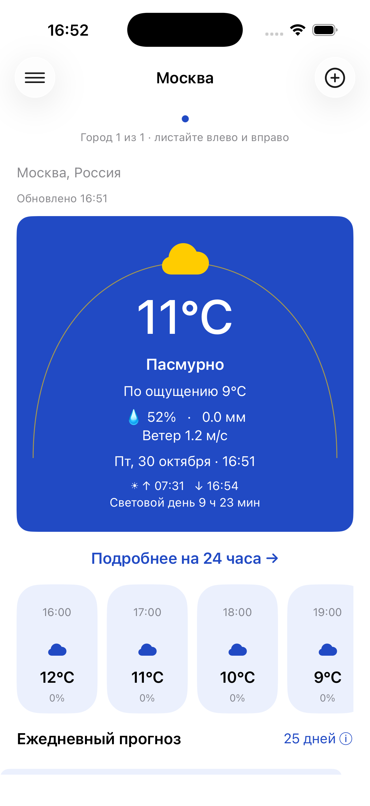
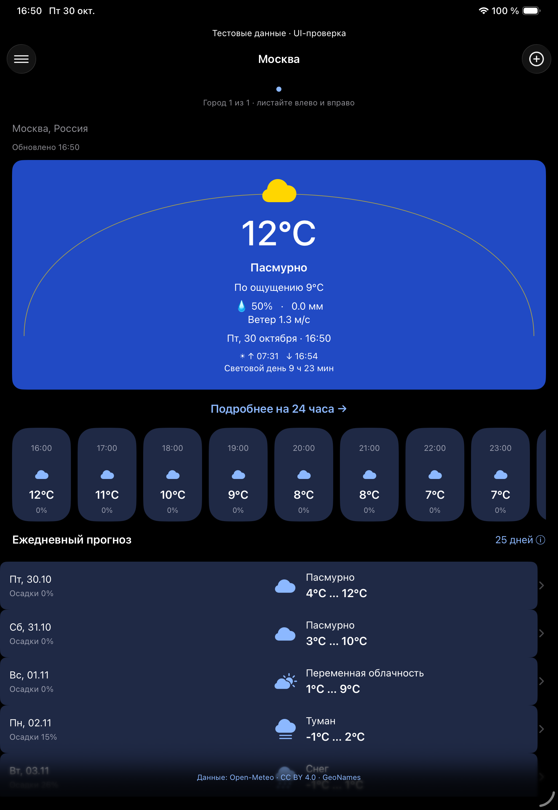

# Погода — диплом Нетологии

UIKit-приложение для нескольких городов: текущая погода, 7 дней, 24 ближайших часа, дневная детализация, геопозиция и полный офлайн-кэш Core Data. Не требует API-ключа. Учебное некоммерческое использование.

## Запуск

Откройте `WeatherDiploma.xcodeproj`, выберите shared scheme **WeatherDiploma** и установленный iOS Simulator. Минимальная версия iOS — 17, язык — Swift 6, устройства — iPhone/iPad. Внешних зависимостей нет; установка CocoaPods или SPM-пакетов не требуется.

```sh
xcodebuild -list -project WeatherDiploma.xcodeproj
xcodebuild -project WeatherDiploma.xcodeproj -scheme WeatherDiploma \
  -configuration Debug -destination 'generic/platform=iOS Simulator' \
  -derivedDataPath /tmp/WeatherDiplomaDerivedData CODE_SIGNING_ALLOWED=NO build
xcodebuild -project WeatherDiploma.xcodeproj -scheme WeatherDiploma \
  -destination 'platform=iOS Simulator,name=iPhone 17 Pro' \
  -derivedDataPath /tmp/WeatherDiplomaDerivedData CODE_SIGNING_ALLOWED=NO test
```

Укажите имя уже установленного симулятора. Скрипт `scripts/generate_project.py` воспроизводит `.xcodeproj` стандартной библиотекой Python 3; запускать его для обычной сборки не нужно.

## Как пользоваться

При первом запуске разрешите геопозицию или выберите ручной ввод. Кнопка «+» открывает системный диалог; при неоднозначном названии выберите регион и страну. Между городами можно листать горизонтально или нажимать индикатор страниц. Потяните прогноз вниз для обновления. Нажмите час, «Подробнее на 24 часа» или день для деталей.

Настройки сохраняют °C/°F, м/с или мили/ч и формат 12/24 часа. «Мои города» позволяет выбрать или удалить город. Уведомления — локальное ежедневное напоминание в 08:00 по часовому поясу устройства, без фоновой загрузки погоды; настройка применяется сразу после системного согласия. Геопозиция запрашивается повторно только по явному нажатию «Моё местоположение».

При запуске сначала читается сохранённый прогноз, затем выполняется запрос. Сеть недоступна — все ранее показанные данные остаются доступны. Данные старше часа помечаются устаревшими. Без кэша отображаются ошибка и повторная загрузка; без городов — ручное добавление. При отсутствии сети геокодинг нового города недоступен.

## Источники и ограничения

- [Официальное задание](https://github.com/netology-code/iosdt-diplom), README и Design просмотрены на commit `35509fd6994f4dd250344528ed5f5fd394a88034`. Визуальная основа — синие карточки, оранжевые действия, горизонтальные часы и дневные строки из Design/1–5.jpg, addScreen.png, mapOfApp.png. Иллюстрация onboarding заменена системным символом зонта; это адаптация, не пиксельная копия Figma.
- [Open-Meteo Forecast API](https://open-meteo.com/en/docs), [Geocoding API](https://open-meteo.com/en/docs/geocoding-api), [условия](https://open-meteo.com/en/terms). Free API предназначен для некоммерческого использования, до 10 000 запросов/день, 5 000/час, 600/мин. Атрибуция: Open-Meteo, CC BY 4.0; геокодинг GeoNames, CC BY.
- Реализован честный прогноз на 7 дней. Обычный API ограничен 16 днями. Кнопка «25 дней» объясняет недоступность; выдуманных дополнительных дней нет.
- Виджет со звёздочкой не реализован. Фазы Луны и качество воздуха не запрашиваются этим провайдером и не показываются. Дневная детализация содержит реальные показатели дня/ночи, солнце, УФ и почасовые данные.
- «День» и «Ночь» — реальные репрезентативные часы выбранного дня, помеченные временем; это не искусственно рассчитанные сводные значения. Полярные день/ночь и отсутствующие значения обозначаются явно.
- Производственная публикация в App Store, подпись для физического устройства и установка на iPhone не выполняются этим PR.

## Проверки и устройство кода

[Отчёт и матрица требований](docs/VALIDATION.md) · [Архитектура](docs/ARCHITECTURE.md) · [Скриншоты](docs/evidence/)

`WeatherDiplomaTests` проверяет DTO, null и повреждённые массивы, контракт URL, геокодинг через URLProtocol, ошибки HTTP/офлайн, повторное открытие SQLite, изоляцию городов, настройки и DST. `WeatherDiplomaUITests` выполняет пользовательские сценарии и сохраняет скриншоты в xcresult. UI-транспорт включается только явными DEBUG-аргументами `--ui-testing --fixture-network`, использует отдельные defaults/SQLite и показывает баннер «Тестовые данные». Обычный Debug и Release работают с реальной сетью. `--offline` в тестах — ошибка транспорта `URLError.notConnectedToInternet`, а не выключение сети всего Mac.

Данные фикстуры взяты из реального ответа Open-Meteo 30.10.2026 для Москвы; это только воспроизводимый тестовый образец, не актуальный прогноз для другого города. Его содержимое никогда не подменяет ответ обычного запуска.

## Фактический результат на Mac

Xcode 26.6 / iOS Simulator 26.5: Debug и Release **BUILD SUCCEEDED**; **12 unit**, **6 различных iPhone UI** и **2 iPad UI** прошли без ошибок (некоторые UI-кейсы повторены после правок). Исполнение на iOS 17 и физическом устройстве не проверялось.

| Обычный запуск, живая сеть | iPad, тёмная тема, тестовый транспорт |
|---|---|
|  |  |

[PR для проверки диплома #1](https://github.com/Revangar/ios-weather-diploma/pull/1) — открыт, не мержен.
