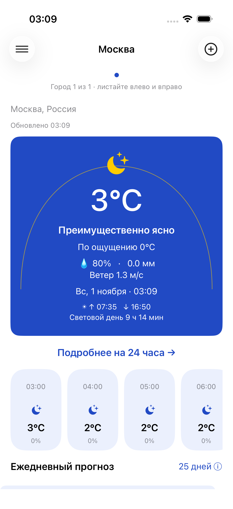
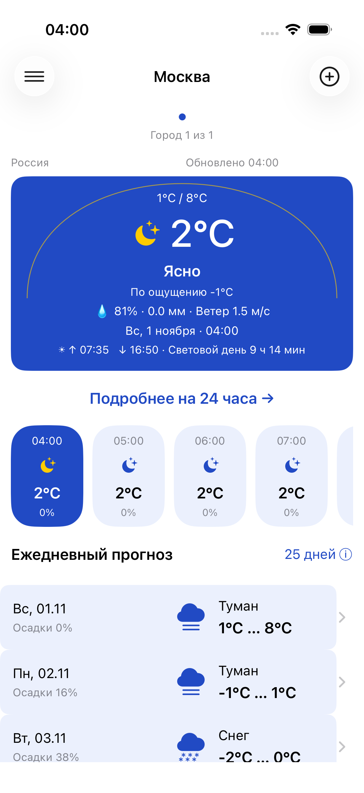
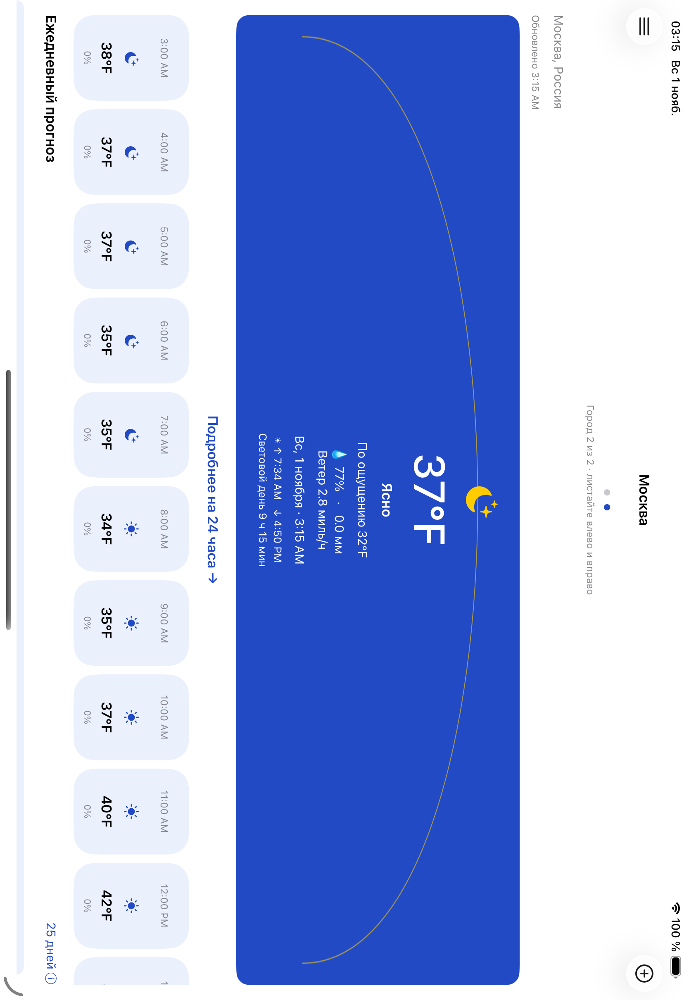
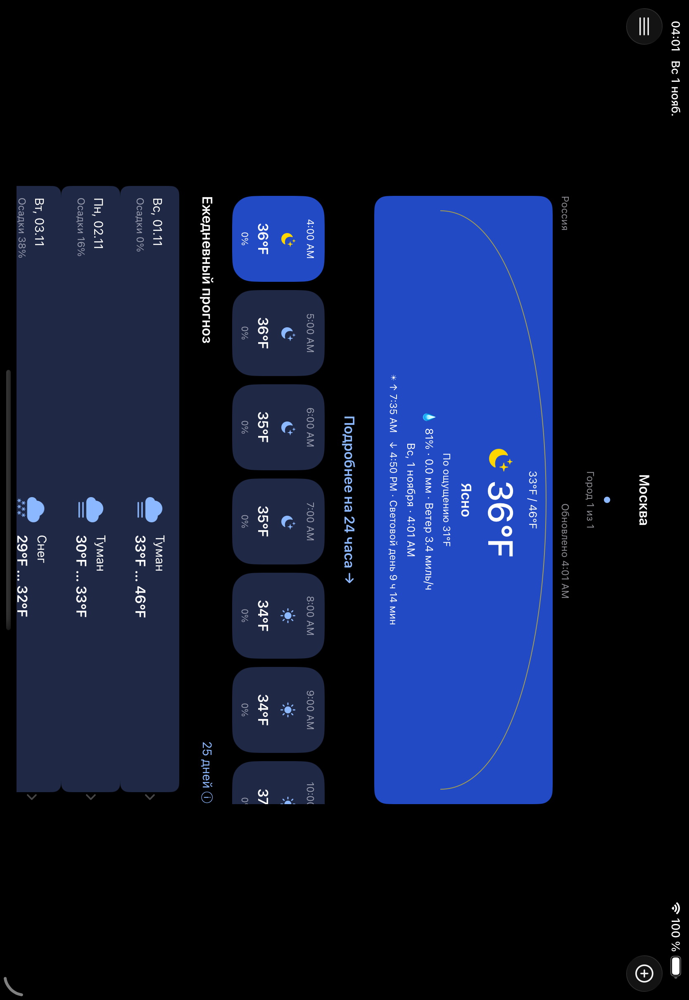

# Финальное инженерное и визуальное ревью — 01.11.2026

Проверяемая база: `0321ee03c318179ee362096030077a84f2b6b6ad`, текущая ветка `feature/diploma-weather-app`, существующий PR #1. Main не изменяется. Это новый прогон; результаты 30 октября не используются как доказательство сегодняшнего запуска.

Для ревью созданы отдельные iPhone 17 Pro и iPad Pro 11-inch M5 на **уже установленном iOS 26.5**. Исходные Simulator и их данные не сбрасывались. Runtime/SDK/components не скачивались. Xcode 26.6 (17F113).

## Выполненные действия в обычном приложении

`testLiveUserJourney` запускает `XCUIApplication` с **пустыми launchArguments и launchEnvironment**, использует обычные UserDefaults/Weather.sqlite и настоящие HTTPS-эндпоинты. UI управляется XCTest, но приложение не включает DEBUG test harness, не использует URLProtocol и не показывает fixture-баннер. Это исполнение приложения, а не просмотр исходников.

На iPhone и iPad до исправлений, затем после исправлений выполнены:

- первый запуск и onboarding, нажатие **«Запретить» в настоящем системном диалоге**;
- ручной поиск Moscow/Берлин с настоящим геокодингом, выбор страны, загрузка обоих прогнозов;
- 24 часа, дневные детали/выбор дня, прокрутка до седьмого дня;
- восемь чередующихся быстрых свайпов между городами, проверка доступности настроек после каждого; повторное получение свежего прогноза;
- °F, мили/ч, 12-часовой формат, повторный запуск без onboarding и сохранение настроек;
- удаление Берлина через UI и проверка оставшегося города;
- сброс только разрешения геопозиции **собственного review-устройства**, запрос из настроек и нажатие **«При использовании приложения»**; отсутствие повторной Москвы после исправления;
- portrait/landscape; отдельно автоматические сценарии максимального Dynamic Type и тёмной темы iPad.

Обычный запуск проверялся отдельно от шести воспроизводимых UI-кейсов с fixture-транспортом. Они подписаны раздельно в именах скриншотов и receipts.

## Найдено и исправлено

| Проблема | Основание | Исправление / проверка |
|---|---|---|
| Карточка iPhone занимает почти весь первый экран вместе с часами | Новый живой скриншот «до»; список дней почти не виден | Компактная композиция текущей температуры, min/max, состояния, показателей и солнца. Все значения сохранены; высота зависит от текста, не фиксирована |
| При максимальном Dynamic Type header iPhone выходит за горизонтальные края | Визуальный просмотр выявил дефект, старый тест проверял только достижимость дня | Через LLDB подтверждено: pager шириной 668.7 pt на экране 402 pt. Добавлен обязательный верхний предел ширины safe area для pager/контейнеров; header получает явную ширину, заголовок дней располагается вертикально. UI assertions проверяют и элементы, и таблицу относительно экрана |
| Контент iPad растягивается в landscape | Обычный запуск, сравнительные PNG | Центрированная область до 760 pt на погоде/деталях/городах; onboarding до 600 pt |
| Дубль Москвы после reduced-accuracy location | **Воспроизведено**: ручной центр 55.75204/37.61781 и geo 55.7307958/37.6361917, одинаковые имя/страна/регион | Geo-результат сопоставляется в пределах 10 км при совпадении этих трёх полей; разные вручную выбранные города не склеиваются. Unit и обычный UI |
| Смена loading-root до завершения appearance | В диагностическом обычном запуске UIKit сообщил Unbalanced begin/end appearance | Открытие хранилища и замена root запускаются после viewDidAppear загрузочного controller; повторены startup/cache/navigation UI |
| Writer создавался до загрузки stores | Новое предупреждение Core Data в реальном логе | Создание writer перенесено после успешного loadPersistentStores; повторены unit и обычный offline-cache запуск |
| Поздний ответ после удаления города мог воссоздать orphan cache | Анализ воспроизводимого порядка событий; новый управляемый provider в тесте | Одна private writer queue для городов/прогнозов, проверка существования города перед записью. Regression PASS |
| Поздняя ошибка отменённой Task могла перезаписать новое состояние страницы | Отсутствовала проверка поколения в catch | Проверка requestID/cancellation перед сообщением; дополнительная проверка после чтения кэша. Тест некооперативного provider подтверждает, что отменённый результат не перезаписывает кэш |
| Старый reverse-geocoding мог завершить новый location-запрос | Не было request identity, Task и CLGeocoder не отменялись | Менеджер и UUID на запрос, проверка источника callback, отмена geocoding/таймера, очистка continuation, cancellation handler |
| GPS timeout шёл во время человеческого решения | Таймер запускался одновременно с системным запросом | Запуск таймера после разрешения; при полученных координатах медленный reverse-geocoding допускает координатный fallback. Долгое ожидание пользователя отдельно не замерялось |
| Английская ошибка сети и неверное «Офлайн» при любой ошибке кэша | Английская DNS-ошибка видна на обычном offline-скриншоте | Русские сообщения для ошибок соединения/таймаута; HTTP/ошибка сохранения не маскируются под отсутствие сети |
| Атрибуция section-footer могла накрывать последний день | Floating footer у plain UITableView, скриншоты | Обычный tableFooterView, масштабируемая высота для Dynamic Type |
| Состояние выбранного часа не видно в ленте | Сравнение с Design/5.jpg | Синяя выбранная капсула, полная accessibility-подпись, selected trait; выбранный день сохраняется в видимой области |
| Низкий контраст белого текста оранжевой кнопки | Расчёт по заданным RGB | Оттенок сохранён оранжевым, номинальный контраст 3.375:1 → 4.664:1; это не сертификация всей доступности |
| Координатный UI-тест iPad свайпал часы после уплотнения | Первый полный iPad-прогон: один FAIL на ожидании Москвы | Жест привязан к weather-table, а не ко всему экрану; производственная навигация не переделывалась под тест |

## Сверка с макетами Нетологии

Прочитаны и просмотрены **Design/1.jpg–5.jpg, addScreen.png, mapOfApp.png**. Remote HEAD репозитория Нетологии по-прежнему `35509fd6994f4dd250344528ed5f5fd394a88034`.

| Макет | Результат сверки |
|---|---|
| 1 — onboarding | Сохранены синий фон, оранжевое действие и ручной отказ. Системный зонт заменяет авторскую иллюстрацию; текст объясняет передачу координат. Ограничена ширина на iPad; scroll для больших шрифтов |
| 2 — settings | Те же четыре группы управления, синяя подложка и светлые/тёмные карточки, оранжевое сохранение. Системная таблица/навигация адаптированы для iOS и доступности |
| 3 — главный экран | Компактная синяя карточка с солнечной дугой, min/max и центральной температурой; часы и ежедневный список видны раньше. Набор показателей не сокращён |
| 4 — 24 часа | Горизонтальный выбор часа и список подробных показателей. Линейный график температуры исходного рисунка не реализован; данные показаны в капсулах и строках, это сохранённое отличие, а не pixel-perfect claim |
| 5 — часы | Скроллируемые капсулы, иконки и выбранный синий час; Dynamic Type увеличивает их вместо обрезания текста |
| addScreen | Пустой экран с заметным добавлением города; понятное объяснение ручного ввода |
| mapOfApp | Маршруты settings/add/hour/day и выбор дня пройдены. Луна/качество воздуха и дополнительный виджет остаются вне реализации; значения не фабрикуются |

## Офлайн в обычном приложении

Для свежего процесса обычного приложения применён **процессный sandbox ОС: запрет внешних исходящих соединений, локальные служебные соединения разрешены**. Ограничение накладывает внешний диагностический dylib через `SIMCTL_CHILD_DYLD_INSERT_LIBRARIES`; приложение, URLSession, адреса API и SQLite не подменяются. Сначала profile скомпилирован на Mac, затем применён `sandbox_apply_bytecode` только к процессу приложения. Первая попытка с sandbox_init не сработала из-за отсутствия compiler library в Simulator; она **не засчитана**. Первый успешный профиль `(deny network*)` был сужен до `(deny network-outbound)` с исключением localhost для служебной автоматизации. Успешные попытки записали `WEATHER_REVIEW_NETWORK_SANDBOX result=0 errno=0`, URLSession получил реальную DNS/сетевую ошибку, после перезапуска показан сохранённый прогноз и открыты кэшированные детали.

У Mac не отключались интерфейсы, VPN, DNS и proxy, не устанавливался firewall. Ограничение исчезает при завершении данного процесса; следующий запуск без внешнего dylib снова обновляет данные. Это проверка отказа сетевого доступа на уровне процесса, **не испытание физического Wi-Fi/airplane mode**. Копии диагностического C-кода и команды сохранены в [diagnostics](diagnostics/README.md); исполняемые файлы остаются в родительском work/review-20261101 и не включены в app bundle/Release.

## Память и отзывчивость

В живом процессе выполнен `leaks`; исходный результат: 0 leaks / 0 leaked bytes. Дополнительно regression-тест проверяет освобождение ForecastDetailViewController и ReadableContainer после удаления сильных ссылок. После навигационного цикла второй `leaks` также показал **0 leaks / 0 leaked bytes** (footprint 70 MB, peak 75.6 MB). Сохранены [исходный](leaks-initial.txt) и [после навигации](leaks-after-navigation.txt) отчёты. После окончательной правки ширины выполнен третий `leaks` обычного процесса: **0 leaks / 0 bytes**, [полный отчёт](leaks-final-layout.txt). Первые два отчёта предупреждают об ограничении просмотра содержимого памяти для restricted process; полный malloc stack trace/обзор memgraph не заявляется. Это не доказательство отсутствия всех возможных утечек и не длительный soak-test.

Быстрые свайпы используют скорость 750 px/s; после каждого проверяется доступность настроек; после серии ожидается успешное обновление прогноза текущей страницы. XCTest ждёт quiescence между действиями: это реальная интерактивная проверка, но не FPS-бенчмарк. Не фиксировалось зависаний в выполненных сценариях; гарантия отсутствия любого подвисания не заявляется.

## Что не проверено / сохранённые ограничения

Физические устройства, iOS 17 runtime, длительный нагрузочный/energy test, ручной проход VoiceOver, фактическая доставка напоминания в 08:00, App Store signing. 25-дневный прогноз недоступен и объяснён в UI; виджета нет. Минимальный iOS target — 17, исполнение этого ревью — только iOS 26.5. Privacy/model schema не менялись; миграция из выдуманной старой схемы не заявляется.

Часть проверок обычного запуска и утечек относится к Debug. Release реально собирался; отдельные Release UI-сценарии не засчитываются без соответствующего запуска.

## Повторяемость проверки

Обычные сетевые integration-кейсы opt-in: `LiveReviewUITests` пропускается без `WEATHER_RUN_LIVE_REVIEW=1` в **test runner**. Поэтому стандартная команда тестов не начинает удалять города из обычного пользовательского профиля и не зависит от доступности Open-Meteo. Приложение не читает эту переменную; его launchArguments остаются пустыми. Live-кейсы запускались только на созданных для ревью устройствах.

Для воспроизведения нужны существующий runtime, отдельное пустое review-устройство и внешний диагностический dylib/скомпилированный sandbox profile для offline-кейса. Использовались `TEST_RUNNER_WEATHER_RUN_LIVE_REVIEW=1` и `TEST_RUNNER_WEATHER_REVIEW_NETWORK_DYLIB=...`; префикс TEST_RUNNER передаёт переменные XCTest runner. Само приложение получает DYLD_INSERT_LIBRARIES только в процессе проверки отказа сети; следующий запуск очищает launchEnvironment и подтверждает сетевое обновление.

Короткая запись Animation Hitches была предпринята, но Instruments вернул **Hitches is not supported on this platform** для Simulator. Ранние попытки без --device не смогли найти PID в пространстве host targets. Ни одна попытка не засчитана как успешное измерение FPS/hitches. Платформенные компоненты ради этого не ставились. Сохранены лог отказа Instruments, успешные runtime leaks и результаты интерактивных UI-проверок.

## Скриншоты до / после

На всех `*-live-*` показан обычный app с настоящими данными; номера 14–16 относятся к процессному offline, 17 — к восстановленной сети. PNG без `live` — воспроизводимый fixture-прогон с видимым баннером. Время и погода между снимками различаются, поэтому они не являются сравнением одинакового сетевого ответа.

| iPhone, до | iPhone, после |
|---|---|
|  |  |

По синей области на снимках 1206×2622: примерно 342 → 214 pt (−37%). На первом экране после правки видны две целые строки дней и начало третьей. При accessibility-размере карточка намеренно растёт; данные доступны прокруткой.

| iPad landscape, до | iPad landscape, после |
|---|---|
|  |  |

Все ключевые экраны: [до](before/), [после](after/). После XCTest дополнительно запущен обычный app через simctl без аргументов и внешнего dylib: [iPhone](after/iphone-live-18-final-normal-launch.png), [iPad](after/ipad-live-18-final-normal-launch.png). В частности [24 часа](after/iphone-live-05-hours.png), [дневные детали](after/ipad-live-06-daily.png), [7 дней](after/iphone-live-07-seven-days.png), [настройки](after/iphone-live-09-settings.png), [максимальный Dynamic Type portrait](after/iphone-13-accessibility-portrait.png), [iPad accessibility landscape](after/ipad-14-accessibility-landscape.png).

## Результаты повторных сборок и тестов

Полные логи/xcresult находятся в родительском `outputs/`, вне Git; компактные JSON-сводки, хэши исходников/логов и строки результатов сохранены в [results.json](results.json) и [checks.txt](checks.txt). Повторы не складываются в число уникальных тестов.

| Проверка | Результат | Локальное доказательство |
|---|---|---|
| Debug generic iOS Simulator, окончательные исходники | BUILD SUCCEEDED | review-debug-acceptance-build.log |
| Release generic iOS Simulator, окончательные исходники | BUILD SUCCEEDED | review-release-acceptance-build.log |
| iPhone: полный прогон после основных правок | 16 unit + 6 fixture UI + 1 обычный live UI, 0 failures | review-final-iphone.xcresult |
| iPad: исправленный полный прогон | 16 unit + 6 fixture UI + 1 обычный live UI, 0 failures | review-final-ipad-corrected.xcresult |
| После последней правки loading-root, каждый девайс | 16 unit + основной fixture UI + обычный OS-offline UI, 0 failures | review-final-lifecycle-iphone/ipad.xcresult |
| Финальный полный прогон на окончательном коде, iPhone | 16 unit + 6 fixture UI + 2 ordinary integration UI, 0 failures | review-acceptance-iphone.xcresult |
| Финальный полный прогон на окончательном коде, iPad | 16 unit + 6 fixture UI + 2 ordinary integration UI, 0 failures | review-acceptance-ipad.xcresult |
| Стандартный запуск opt-in integration без разрешающей переменной | 2 SKIPPED, 0 failures; не считаются PASS | review-default-integration-gate.xcresult |
| Проверка leaks, три живых процесса (включая окончательный код) | 0 leaks / 0 bytes в каждом снимке | leaks-*.txt |
| Animation Hitches | UNSUPPORTED, измерение не выполнено | animation-hitches-unsupported.txt |

Итого покрыты **16 разных unit, 6 fixture UI и 2 обычных integration UI на каждом устройстве**. После последней правки Dynamic Type оба полных набора повторены на окончательном коде, включая все unit, fixture и ordinary integration-сценарии. Release UI не запускался.

Первый полный iPad-прогон `review-final-ipad.xcresult` содержал **1 FAIL**: после уменьшения карточки тест свайпал вложенную часовую коллекцию. Исправлен только адрес жеста теста. Полный corrected-прогон и отдельный iPhone повтор подтвердили исправление. Этот FAIL сохранён в results.json; позднейшие PASS не переписывают историю. При последующей правке Dynamic Type первая попытка привязать header к внешней таблице до добавления в иерархию вызвала исключение Auto Layout и два неуспешных adaptive-прогона. Исправлено локальным width constraint header. Сначала adaptive assertions проходили, но визуальное обрезание сохранялось: элементы помещались в слишком широкую таблицу. LLDB выявил превышение ширины всего pager; добавлен предел safe area и проверка таблицы относительно app.frame. Все попытки сохранены в receipts. [Промежуточный снимок обрезания](before/iphone-accessibility-clipped-intermediate.png) показывает причину последней правки.

В build-логе остаётся штатное предупреждение AppIntents metadata extraction (framework не используется). В части test-логов встречались диагностическое сообщение Xcode DebuggerVersionStore и runtime-предупреждение дублированного WebKit accessibility class. Платформенные файлы не менялись. В финальных lifecycle- и acceptance-прогонах нет прежних сообщений Core Data `no stores` и UIKit `Unbalanced begin/end appearance`.

## Публикация

Изменения выполняются только в `feature/diploma-weather-app`, [существующий PR #1](https://github.com/Revangar/ios-weather-diploma/pull/1). PR не мержится; main остаётся на `0ffb5e80d25bf476625aca98c9c82ee8c1e06595`. Исправления: commit `85daa7b`. Последующий commit содержит документацию, сводки и PNG. GitHub CI не настроен; это локально выполненные проверки на Mac.

## Использованные команды финального прогона

Из родительского рабочего каталога (все bundle/log пути вне Git):

```sh
xcodebuild -project outputs/ios-weather-diploma/WeatherDiploma.xcodeproj \
  -scheme WeatherDiploma -configuration Debug -destination 'generic/platform=iOS Simulator' \
  -derivedDataPath work/ReviewDebugStandalone CODE_SIGNING_ALLOWED=NO build
xcodebuild -project outputs/ios-weather-diploma/WeatherDiploma.xcodeproj \
  -scheme WeatherDiploma -configuration Release -destination 'generic/platform=iOS Simulator' \
  -derivedDataPath work/ReleaseDerived CODE_SIGNING_ALLOWED=NO build
xcodebuild -project outputs/ios-weather-diploma/WeatherDiploma.xcodeproj \
  -scheme WeatherDiploma -configuration Debug -destination 'generic/platform=iOS Simulator' \
  -derivedDataPath work/DerivedData CODE_SIGNING_ALLOWED=NO build-for-testing
TEST_RUNNER_WEATHER_RUN_LIVE_REVIEW=1 \
TEST_RUNNER_WEATHER_REVIEW_NETWORK_DYLIB="$PWD/work/review-20261101/deny_network.dylib" \
xcodebuild -project outputs/ios-weather-diploma/WeatherDiploma.xcodeproj \
  -scheme WeatherDiploma -destination 'platform=iOS Simulator,id=F756165E-B169-4486-BC43-93D8C72903F7' \
  -derivedDataPath work/DerivedData -resultBundlePath outputs/review-acceptance-iphone.xcresult \
  -parallel-testing-enabled NO CODE_SIGNING_ALLOWED=NO test-without-building
```

Вторая тестовая команда идентична, destination `7C7D0173-D3FD-4B7C-ABFD-25B0910F75D1`, bundle `review-acceptance-ipad.xcresult`. Перед ordinary journey review-приложение установлено с чистыми данными и сброшенным только его location permission на этих двух собственных устройствах. Исходные пользовательские Simulator не затронуты. Для отдельного adaptive-прогона использован `-only-testing:WeatherDiplomaUITests/WeatherDiplomaUITests/testAdaptiveLandscapeAndLargeText`.
