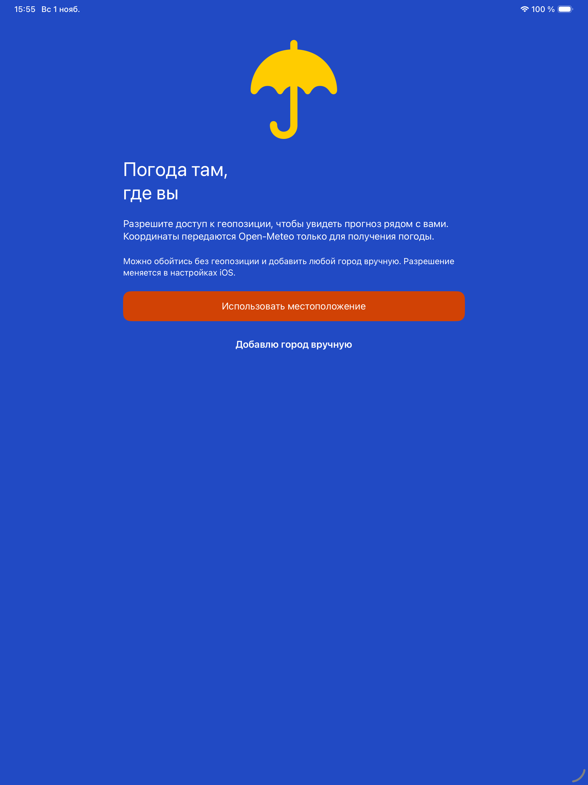
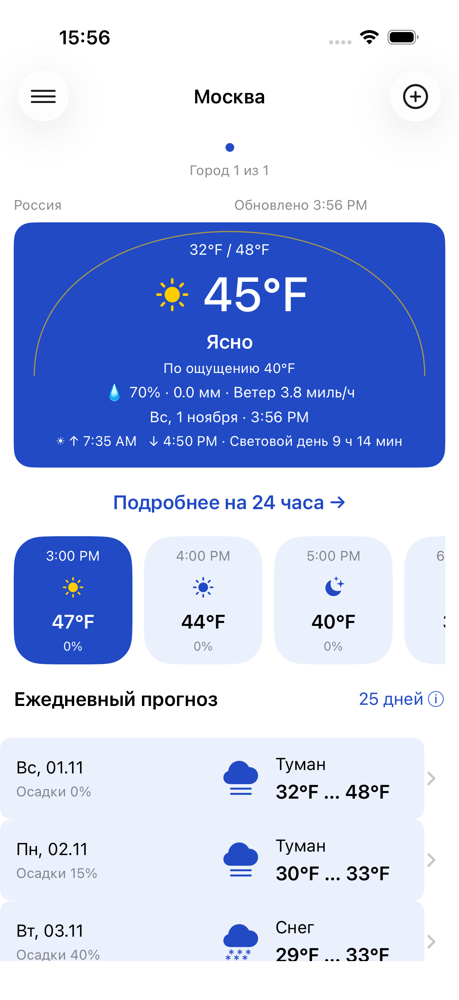

# Проверка запуска и исправление заголовка погоды — 1 ноября 2026

Дальнейшая проверка ограничена **только Simulator**. Физические устройства исключены из итоговой приёмки этого изменения. Xcode 26.6, уже установленный iOS Simulator 26.5. Runtimes/platform components не устанавливались.

## Подтверждённый дефект

Заголовок главного экрана устанавливался в UITableView до измерения, с обязательной шириной `max(24, tableView.bounds.width)`. Страница UIPageViewController может загружаться при ширине 0: получался constraint `header.width == 24`. Затем UIKit задавала ширину 760 и высоту 0 через `UIView-Encapsulated-Layout-*`. Результат — реальные сообщения `Unable to simultaneously satisfy constraints` и разрывы отступов заголовка. Краткая обезличенная выдержка сохранена в [constraint-excerpt.txt](constraint-excerpt.txt).

Исправление: новый заголовок хранится в `pendingHeader`, пока ширина страницы не станет ненулевой. Сначала вычисляется подходящая высота, затем задаётся frame и заголовок присоединяется к таблице. Постоянный width constraint и заглушка 24 pt удалены. Задержек `asyncAfter` и сброса данных нет.

**Связь этого дефекта с исходным постоянным пустым синим экраном не доказана. Постоянный синий экран устойчиво не воспроизведён; его точная первопричина остаётся неустановленной.** Поэтому исправление Auto Layout не объявляется доказанным устранением именно первоначального симптома. Скриншоты ниже подтверждают фактический запуск интерфейса на Simulator, без утверждения о физическом iPad.

## Проверенные компоненты

Проверены `SceneDelegate`, `AppCoordinator`, `LoadingViewController`, `CoreDataStack.make()`, `WeatherRootViewController.restore()` и Onboarding. Диагностическая последовательность доходила до загруженного хранилища, установленного UINavigationController и готового root/onboarding. Временные trace/capture-вставки удалены до финальных сборок.

Ранний нулевой frame содержимого Onboarding в `viewDidLayoutSubviews` после кадров отрисовки сменялся корректным размером. Этот ранний срез не используется как доказательство постоянного дефекта или его устранения. В этих компонентах подтверждённой причины синего окна не установлено; они не изменены в итоговом патче.

## Изменённые файлы

- `WeatherDiploma/UI/WeatherViewController.swift`: измерение заголовка до установки в UITableView, ожидание ненулевой ширины страницы.
- `WeatherDiplomaTests/WeatherDiplomaTests.swift`: regression геометрии при размерах 0 → 760 → 320 → 600 pt.
- `WeatherDiplomaUITests/WeatherDiplomaUITests.swift`: opt-in обычный запуск с пустыми arguments/environment и повторный запуск, проверка доступного действия. Снимки ограничены областью приложения через `app.screenshot()`.

Локальные пользовательские настройки подписи Xcode в `project.pbxproj` сохранены и не включены в коммит.

## Фактически выполненная проверка на Simulator

| Проверка | Результат | Локальный receipt |
|---|---|---|
| Debug generic Simulator build | BUILD SUCCEEDED | simulator-debug-build.log |
| Release generic Simulator build | BUILD SUCCEEDED | simulator-release-build.log |
| Окончательный iPhone Simulator | 17 unit + 7 UI, 0 failures | simulator-accepted-iphone.xcresult |
| Окончательный iPad Pro 13 Simulator | 17 unit + 7 UI, 0 failures | simulator-accepted-ipad.xcresult |

Из семи UI-кейсов шесть fixture и один обычный startup/relaunch без тестовых app flags. Повторы не складываются в число уникальных тестов.

Обычный startup-тест использует настоящий профиль приложения и реальную сеть, без `--ui-testing`/`--fixture-network`. Он включается только `TEST_RUNNER_WEATHER_REVIEW_NORMAL_STARTUP=1`. Остальные шесть UI-кейсов используют отдельные fixture namespace и видимый баннер. Системные диалоги геопозиции настоящие.

На новом iPad Pro 13 Simulator выполнена чистая установка; ранее установленные пользовательские Simulator не сбрасывались. Для сценария разрешения GPS заданы координаты `simctl location ... set 55.75,37.62`. Первый полный прогон без координат дал один FAIL в GPS-сценарии; отдельный исправленный повтор прошёл, затем окончательный полный набор повторён с координатами. История неуспешного запуска сохранена в receipts.

Полные логи/xcresult: родительский `outputs/startup-ipad-20261101/`, вне Git. [Компактные сводки и хэши](results.json).

## Скриншоты обычного запуска

| iPad Simulator: обычный запуск | iPhone Simulator: обычный повторный запуск |
|---|---|
|  |  |

[Отказ геопозиции](ipad-11-location-denied.png) · [Разрешение геопозиции, fixture](ipad-12-location-allowed.png) · [Крупный текст](ipad-13-accessibility-portrait.png) · [Landscape](ipad-14-accessibility-landscape.png).

Не заявляются финальные проверки на физических устройствах, Release UI, других версиях iOS или доказанная причина исходного синего окна. Результаты предыдущего большого ревью не подменяют этот запуск.
